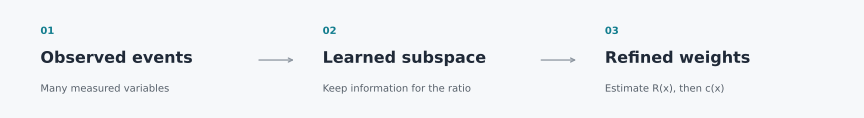
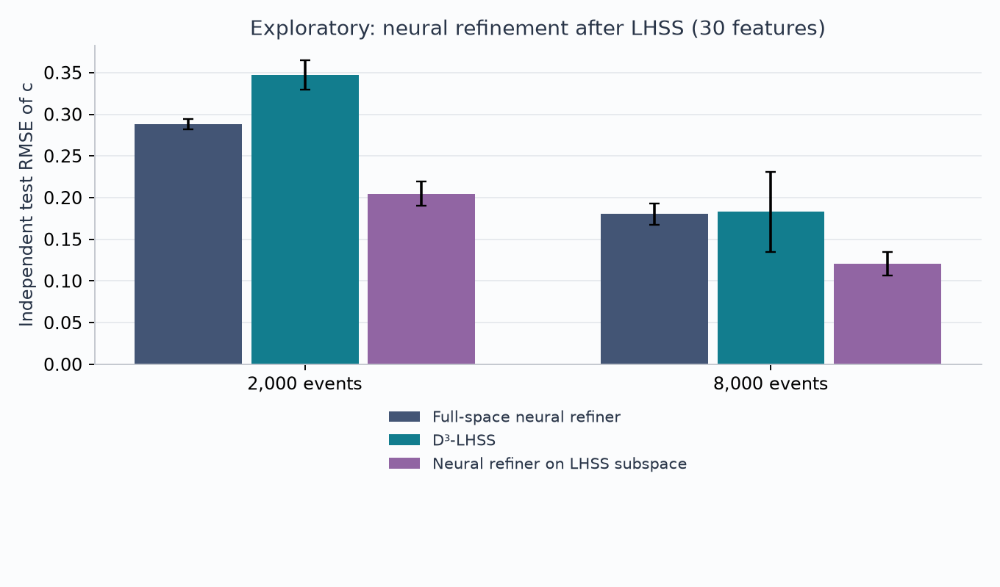

<p align="center"></p>

# Latent Structure for Weight Refinement

**Can shared physical structure reveal a compact representation for signed Monte Carlo weight refinement?**

A small, reproducible Python research study inspired by
[Nachman & Noll's *Stay Positive*](https://arxiv.org/abs/2505.03724).
It combines a complete native D³-LHSS implementation with synthetic signed
samples, validated neural comparisons and simple kernel baselines.

**35 dataset cases · five seeds · independent test events · Python throughout**

## Research question: from physics to latent structure

The starting intuition is physical: simulated events from a common physical
process may share underlying degrees of freedom and correlations, even when
each event is described by many observables. This motivates a hypothesis:
**could the information needed for weight refinement live in a much smaller
latent representation than the observed feature vector?** A low-dimensional
manifold is one possible form of such structure, but a common physical origin
alone does not guarantee that it exists or that it preserves the relevant
density ratio.

Our question is therefore: **can we learn that representation first, then
estimate the negative-to-positive density ratio R(x) using fewer variables,
and improve weight refinement with a kernel method or a neural network?**
The target is a mapping T(x) with k much smaller than the observed dimension d,
such that R(x) is approximately a function of T(x) alone. Preserving this
ratio matters more here than preserving the overall variance of the data.

This repository tests a concrete first step: a **linear subspace sufficient
for the ratio**, learned using D³-LHSS. The main synthetic benchmark deliberately
contains one hidden informative direction; the samples themselves remain
full-dimensional and do not lie on a one-dimensional manifold. A radial
control checks what happens when linear compression discards relevant
information. Thus, we test the benefit of exploitable latent structure under
controlled conditions; discovering a physical manifold or a nonlinear
sufficient representation in collider data remains future work.

## What this project adds

- A controlled comparison of full-space and learned-subspace weight refinement.
- A NumPy/SciPy D³-LHSS estimator, numerically checked against the authors'
  MATLAB reference on four local examples.
- Explicit event-level validation, per-replica results and a radial control
  that challenges aggressive linear compression.

## Results at a glance

<!-- RESULTS:START -->
**A learned subspace can help the neural refiner in this synthetic setting.**
At 30 observed features, fitting the neural refiner on the frozen LHSS
subspace gives approximately **29% and 33% lower mean test error** than
fitting it on all features, with 2,000 and 8,000 events respectively.
This comparison is **exploratory**, motivated during the study and evaluated
on the existing test sets; it needs confirmation on fresh experiments.

The table separates the representation from the final estimator. Both neural
columns use the same architecture and training protocol, with different
input representations. D³-LHSS + kernel changes the final estimator as well.
Values are independent-test c-RMSE, **mean ± standard deviation over five
dataset seeds; lower is better**.

| Events | Features | Neural: all features | Neural: LHSS subspace (exploratory) | D³-LHSS + kernel | Covariance + kernel |
|---:|---:|---:|---:|---:|---:|
| 2,000 | 10 | 0.171 ± 0.017 | **0.112 ± 0.014** | 0.126 ± 0.043 | 0.110 ± 0.026 |
| 2,000 | 30 | 0.288 ± 0.006 | **0.205 ± 0.015** | 0.347 ± 0.017 | 0.166 ± 0.011 |
| 8,000 | 10 | 0.107 ± 0.010 | **0.058 ± 0.026** | 0.053 ± 0.027 | 0.051 ± 0.015 |
| 8,000 | 30 | 0.180 ± 0.013 | **0.120 ± 0.014** | 0.183 ± 0.048 | 0.073 ± 0.005 |

Bold values mark the reduced-input neural comparison, not the best method
in each row.

**The complete LHSS + kernel pipeline has mixed results.** It has lower
mean error than the full-space neural refiner at 10 features. At 30 features
it is worse with 2,000 events and approximately tied with 8,000. The same
learned subspace works better with a neural final estimator in these runs,
suggesting that representation learning and ratio estimation deserve
separate investigation. These results do not show that kernels are generally
better than neural networks, or that dimensionality reduction always helps.

These headline results all come from the native Python suite. Historical
MATLAB benchmarks are kept separate. [Full results and controls](results/report.md).
<!-- RESULTS:END -->



The simple covariance baseline is especially well matched to this Gaussian
construction. A lower error in this benchmark does not establish general
kernel superiority or improved performance on physical event samples.
In the radial control, where every linear direction matters, aggressive
compression loses information. See the [full comparison plot](results/figures/benchmark.png)
and [control results](results/report.md#radial-control).

## Run it

Python **3.12** is the tested environment. From the unzipped repository folder:

```sh
python -m venv .venv
source .venv/bin/activate
python -m pip install -e ".[neural]"
python -m subspace_refinement.benchmark --suite smoke --output runs/smoke
```

On Windows, activate with `.venv\Scripts\activate` instead. The neural extra
installs TensorFlow. For a lighter NumPy/SciPy experiment:

```sh
python -m pip install -e .
python -m subspace_refinement.benchmark --suite smoke --methods d3lhss --output runs/lhss-smoke
```

No data download and no MATLAB installation are required. All inputs are
generated locally. To reproduce the complete study:

```sh
python -m subspace_refinement.benchmark --suite full --output runs/full
python -m subspace_refinement.report --input runs/full/results.csv --output runs/full/report
python -m unittest discover -s tests -v
```

The full suite is substantially slower than the smoke example; runs resume
from completed case/method pairs. Use a new output directory for a fresh run.
[Exact tested versions](requirements-reproduce.txt) are provided separately.

## Explore the study

| Start here | Contents |
|---|---|
| [Experimental protocol](docs/protocol.md) | Distributions, losses, selection and limitations |
| [Results report](results/report.md) | Full tables, dimension choices and diagnostics |
| [Per-case results](results/results.csv) | Every dataset/method evaluation |
| [Quick example](examples/quickstart.py) | Generate, fit and plot a small example |
| [Executed notebook](examples/quickstart.ipynb) | A visual walkthrough you can read on GitHub |
| [Validation note](docs/validation.md) | Numerical parity and an event-split audit |
| [Credits and notices](THIRD_PARTY_NOTICES.md) | Papers, inspected source and licenses |

## Scope and next questions

This is an independent synthetic study. D³-LHSS is an existing algorithm;
the contribution here is its application, comparison and validation in this
weight-refinement setting. The neural architecture follows the public
`weight_refiner` implementation with a stated local training protocol.

Useful next tests include non-Gaussian shifts, nonlinear sufficient features,
selection with nested refitting, and realistic collider samples. Resampling
and preservation of statistical uncertainties are outside this benchmark.

## References

1. B. Nachman and D. Noll, [*Stay Positive: Neural Refinement of Sample Weights*](https://arxiv.org/abs/2505.03724), 2025.
2. M. Sugiyama et al., [*Direct Density-ratio Estimation with Dimensionality Reduction via Least-squares Hetero-distributional Subspace Search*](https://www.ms.k.u-tokyo.ac.jp/sugi/2011/LHSS.pdf), *Neural Networks* 24, 183–198, 2011.
3. D. Noll, [`weight_refiner`](https://github.com/Nollde/weight_refiner), inspected commit `4b3a41ea9ff45d1922068387b04c7c694ce1338a`.

Distributed code: [MIT license](LICENSE). Upstream acknowledgments and retained
license text: [third-party notices](THIRD_PARTY_NOTICES.md).
