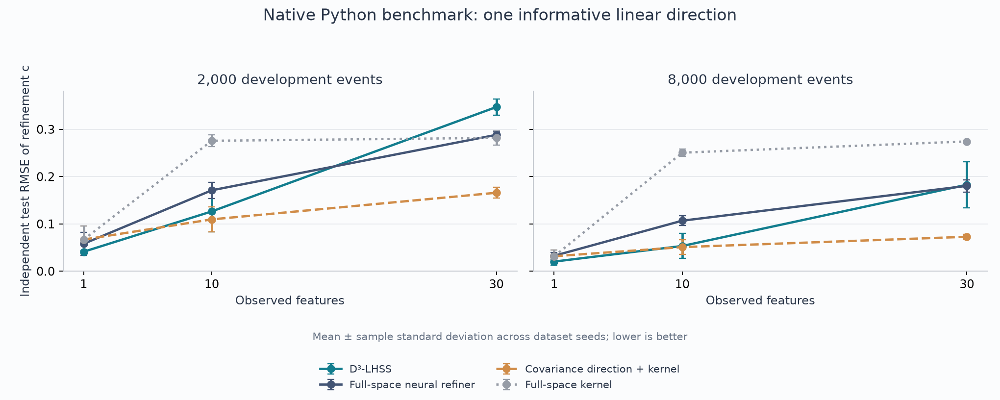
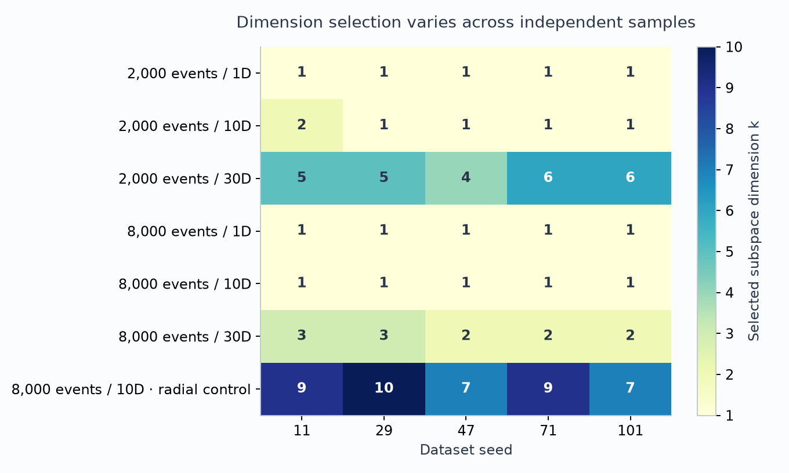

# Native Python results

35 dataset cases; 175 method evaluations.
All development and test samples are synthetic. Test truth is not used for
selection. Tables show mean ± sample standard deviation over dataset seeds;
the per-case CSV records every evaluation and its selected settings.

## Full-space and reduced-space comparison

| Events | Features | D³-LHSS | Full-space neural refiner | Covariance direction + kernel | Full-space kernel |
|---:|---:|---:|---:|---:|---:|
| 2,000 | 1 | 0.041 ± 0.003 | 0.058 ± 0.024 | 0.067 ± 0.029 | 0.067 ± 0.029 |
| 2,000 | 10 | 0.126 ± 0.043 | 0.171 ± 0.017 | 0.110 ± 0.026 | 0.276 ± 0.012 |
| 2,000 | 30 | 0.347 ± 0.017 | 0.288 ± 0.006 | 0.166 ± 0.011 | 0.282 ± 0.015 |
| 8,000 | 1 | 0.020 ± 0.008 | 0.033 ± 0.007 | 0.032 ± 0.013 | 0.032 ± 0.013 |
| 8,000 | 10 | 0.053 ± 0.027 | 0.107 ± 0.010 | 0.051 ± 0.015 | 0.251 ± 0.008 |
| 8,000 | 30 | 0.183 ± 0.048 | 0.180 ± 0.013 | 0.073 ± 0.005 | 0.274 ± 0.001 |

The covariance baseline uses a supplied one-dimensional representation family
and is particularly well matched to this Gaussian rank-one covariance shift.
The learned method must also select its dimension and uses a different
selection protocol. The comparison does not isolate dimensionality alone.

## Selected dimensions

| Scenario | Events | Features | Selected k, ordered by dataset seed |
|---|---:|---:|---|
| all_dimensions_matter | 8,000 | 10 | 9, 10, 7, 9, 7 |
| one_latent_direction | 2,000 | 1 | 1, 1, 1, 1, 1 |
| one_latent_direction | 2,000 | 10 | 2, 1, 1, 1, 1 |
| one_latent_direction | 2,000 | 30 | 5, 5, 4, 6, 6 |
| one_latent_direction | 8,000 | 1 | 1, 1, 1, 1, 1 |
| one_latent_direction | 8,000 | 10 | 1, 1, 1, 1, 1 |
| one_latent_direction | 8,000 | 30 | 3, 3, 2, 2, 2 |

The true sufficient linear dimension is one in the main setting and ten in
the radial control. Choosing k>1 in the main setting can preserve the ratio;
the independent error, rather than k alone, determines whether it generalized.

## Neural refiner on the learned subspace

| Method, 30 observed features | 2,000 events | 8,000 events |
|---|---:|---:|
| Full-space neural refiner | 0.288 ± 0.006 | 0.180 ± 0.013 |
| D³-LHSS | 0.347 ± 0.017 | 0.183 ± 0.048 |
| Neural refiner on LHSS subspace | 0.205 ± 0.015 | 0.120 ± 0.014 |

The learned subspace and selected k are frozen. Only the final estimator is
changed and selected on the external event holdout. This comparison was
designed after the first runs and reuses these test sets, so it was repeated
on fresh dataset seeds: see `results/confirm/report.md`. It supports a
representation benefit without demonstrating a unique advantage of kernel
estimation.

## Radial control

| Method | Radial-control RMSE |
|---|---:|
| D³-LHSS | 0.117 ± 0.023 |
| Full-space neural refiner | 0.122 ± 0.011 |
| Covariance direction + kernel | 0.241 ± 0.003 |
| Full-space kernel | 0.093 ± 0.010 |
| Neural refiner on LHSS subspace | 0.137 ± 0.021 |

The radial control tests linear information loss. Its exact c is negative in
a central region, so it is not a demonstration of an everywhere nonnegative
physical refinement. A nonlinear radial feature would be sufficient.

## Internal selection versus independent risk

| Events | Features | Internal CV risk | Independent test risk |
|---:|---:|---:|---:|
| 2,000 | 1 | -0.758 | -0.755 |
| 2,000 | 10 | -0.771 | -0.694 |
| 2,000 | 30 | -1.135 | -0.159 |
| 8,000 | 1 | -0.761 | -0.759 |
| 8,000 | 10 | -0.756 | -0.747 |
| 8,000 | 30 | -0.771 | -0.620 |

Both columns use the normalized-ratio uLSIF risk (lower is better). Adaptive
reuse during subspace search can make internal scores optimistic. The
comparison does not identify a unique failure mechanism. No nested refitting
of the complete subspace search was added, to retain the reference protocol.

## Limits

- The favorable sufficient direction was constructed, not discovered in
  physical data. There is no collider-data evaluation.
- Five dataset seeds do not establish universal superiority. Error bars are
  standard deviations, not confidence intervals; optimizer RNG is fixed.
- Neural and kernel models have different selection budgets and regularization.
- Nonuniform absolute weights, resampling and uncertainty coverage are not tested.
- Local timings can include cached projections and are not a speed benchmark.

See the repository's `docs/protocol.md` and `docs/validation.md` for full details.
